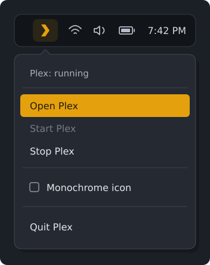

# plex-tray

A small Rust tray app for controlling Plex Media Server on Arch Linux.
Start, stop, and quit Plex, open its web interface, and see its status without
polling. Supports colored and theme-aware monochrome icons.



## Install

Requires the `plex-media-server` package and a StatusNotifier-compatible tray,
such as Waybar or Plasma. GNOME needs an AppIndicator extension.

Install from the [AUR](https://aur.archlinux.org/packages/plex-tray) with an AUR helper such as Paru:

```sh
paru -S plex-tray
```

Or download the x86_64 package from [Releases](https://github.com/bpierre/plex-tray/releases/latest), then install it:

```sh
sudo pacman -U ./plex-tray-0.1.0-3-x86_64.pkg.tar.zst
```

Or build from this checkout with Rust 1.89+, Cargo, and `base-devel` installed:

```sh
makepkg -si
```

Normal administrator authorization is
required for installation; afterward, active local desktop users can start
and stop only Plex without a password. The packaged Polkit rule is removed
on uninstall. It does not grant remote/inactive sessions access or authorize
service-file edits, restart, or control of other services. Plex's service and
libraries remain separate.

To rebuild and update an existing installation, use `makepkg -sif`, then
restart the tray.

## Use

Launch **Plex Media Server** from your application menu.

- **Open Plex** opens the web interface.
- **Start / Stop Plex** controls the service and keeps the tray open.
- **Quit Plex** stops the service and closes the tray.
- **Monochrome icon** switches icon styles and saves your preference.

Launching it again reuses the existing tray and opens Plex if running, or
starts it if stopped. If **Quit Plex** cannot stop the service, the tray stays
open and reports the error.

Colored mode uses orange for running, gray for stopped/transitioning, and red
for errors. Monochrome uses your tray's theme colors; status remains visible
in the menu and tooltip. Hosts that cannot find the symbolic icon use gray.

### Command line

```text
plex-tray [OPTIONS]

--no-start     Show status without starting the service
--monochrome   Use and save the monochrome icon preference
--color        Use and save the colored icon preference
-h, --help     Show help
-V, --version  Show the version
```

For example, change an already-running tray to monochrome without starting
Plex:

```sh
plex-tray --no-start --monochrome
```

Icon preferences are saved in `$XDG_CONFIG_HOME/plex-tray/config`, defaulting
to `~/.config/plex-tray/config`. The setting is `monochrome=true` or `false`.

The controller has no autostart entry. Closing your desktop session does not
stop the system Plex service, and installation does not change whether Plex
starts at boot. For service failures, use `journalctl -u plexmediaserver -n 50`.

## Development

```sh
cargo run -- --no-start
cargo fmt --check
cargo clippy --locked --all-targets -- -D warnings
cargo test --locked --all-targets
```

Policy tests use Node.js 18+, with no npm dependencies:

```sh
node --test tests/polkit.test.cjs
```

See [contributing](CONTRIBUTING.md) for desktop checks and
[releasing](RELEASING.md) for release preparation.

## Remove

Quit Plex from the tray, then run:

```sh
sudo pacman -R plex-tray
```

Your icon preference in `~/.config/plex-tray/` is retained.

## License

[MIT](LICENSE).
